  

  

I'm a Computer Science undergrad at **Amrita Vishwa Vidyapeetham, Chennai**. 
I build complete products, from the database and APIs to the interface people actually use. 
I shipped an IT asset system for the **Airports Authority of India**, and right now I'm building **RAG, computer vision and quantum ML** projects.

 

<table>
<tr>
<td width="50%" valign="top" align="center">

<a href="https://wanderlust-qqct.onrender.com/listings"><b>Live demo ↗</b></a> &nbsp;·&nbsp; <a href="https://github.com/Chetan-Kumar-G/WanderLust">Code</a>
</td>
<td width="50%" valign="top" align="center">

<a href="https://github.com/Chetan-Kumar-G/aai-assetflow"><b>Code ↗</b></a> &nbsp;·&nbsp; built during my internship
</td>
</tr>
<tr>
<td width="50%" valign="top" align="center">

<a href="https://case-link-phi.vercel.app"><b>Live demo ↗</b></a> &nbsp;·&nbsp; <a href="https://github.com/Chetan-Kumar-G/CaseLink">Code</a>
</td>
<td width="50%" valign="top" align="center">

<a href="https://github.com/Chetan-Kumar-G/Karigar"><b>Code ↗</b></a> &nbsp;·&nbsp; Smart India Hackathon 2026
</td>
</tr>
<tr>
<td width="50%" valign="top" align="center">

<a href="https://github.com/Chetan-Kumar-G/marine_trash"><b>Code ↗</b></a> &nbsp;·&nbsp; YOLOv8 + ByteTrack
</td>
<td width="50%" valign="top" align="center">

<a href="https://github.com/Chetan-Kumar-G/Quantum"><b>Code ↗</b></a> &nbsp;·&nbsp; capstone research
</td>
</tr>
<tr>
<td width="50%" valign="top" align="center">

<a href="https://github.com/Chetan-Kumar-G/Sanatan_AI"><b>Code ↗</b></a> &nbsp;·&nbsp; Smart Amrita Hackathon 2026
</td>
<td width="50%" valign="top" align="center">

<a href="https://heatwave-prediction-system.vercel.app"><b>Live demo ↗</b></a> &nbsp;·&nbsp; <a href="https://github.com/Chetan-Kumar-G/heatwave-prediction-system">Code</a>
</td>
</tr>
</table>

<b>More stamps in the archive</b>: smaller builds and coursework

 

| Project | What it is | Links |
|:--|:--|:--|
| **CodeFlow** | Offline-first Chrome extension that tracks coding practice: auto-detects problems, streaks, heatmap, Pomodoro timer | [Code](https://github.com/Chetan-Kumar-G/CodeFlow) |
| **FeastVista** | Food ordering + restaurant table booking with a reactive cart, built with zero UI libraries | [Live](https://chetan-kumar-g.github.io/FeastVista/) · [Code](https://github.com/Chetan-Kumar-G/FeastV) |
| **Algorithms in C** | 20+ classic algorithms (sorting, DP, graphs) with complexity notes | [Code](https://github.com/Chetan-Kumar-G/Design-Analysis-and-Algorithms) |
| **ARM Assembly (Keil)** | Data transfer, arithmetic, logic and shift programs for embedded-systems students | [Code](https://github.com/Chetan-Kumar-G/ARM-Assembly-Keil) |
| **Formly** | Forms app with a Supabase backend, admin sign-in and email auth | [Live](https://chetan-kumar-g.github.io/formly/) · [Code](https://github.com/Chetan-Kumar-G/formly) |
| **Amazon / Flipkart UI** | Front-end layout clones in HTML & CSS | [Amazon](https://github.com/Chetan-Kumar-G/Amazon) · [Flipkart](https://github.com/Chetan-Kumar-G/Flipkart) |

 

  

<table align="center">
<tr><td align="right"><b>LANGUAGES</b></td><td></td></tr>
<tr><td align="right"><b>FRONTEND</b></td><td></td></tr>
<tr><td align="right"><b>BACKEND & DATA</b></td><td></td></tr>
<tr><td align="right"><b>AI / ML</b></td><td> &nbsp;YOLOv8 · RAG · Quantum ML</td></tr>
<tr><td align="right"><b>CLOUD & TOOLS</b></td><td></td></tr>
</table>

 

 

Hiring for an SDE, full-stack or AI/ML internship? <a href="mailto:chetankumarg210307@gmail.com"><b>chetankumarg210307@gmail.com</b></a>

